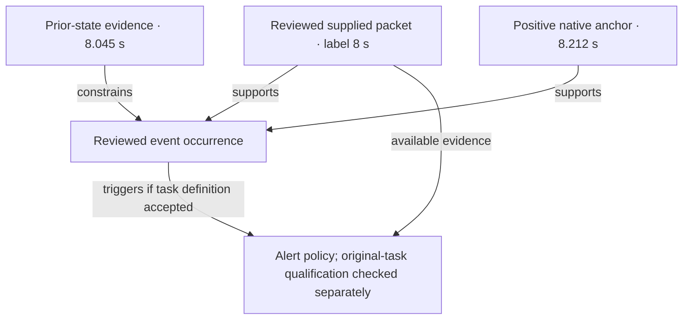

# HA01 — lens_detachment

Task: `stream_alert_01`. Original instruction: Alert when the zoom lens is detached from the DSLR body.

**Single-assistant review; independent adjudication pending.**

Distinct lens detachment, return and cap removal. Preserve historical detachment after current state changes.

Original-task qualification: **provisional**.

## Evidence anchors

| Native frame | Source PTS (s) | Role | Visual evidence |
|---:|---:|---|---|
| [241](../../../../full_review/batch_v1/HA01/anchors/000241.jpg) | 8.044704 | pre | Lens appears seated against the body; mount lock is not visible. |
| [243](../../../../full_review/batch_v1/HA01/anchors/000243.jpg) | 8.111465 | transition | Lens moving away; release boundary partly occluded. |
| [246](../../../../full_review/batch_v1/HA01/anchors/000246.jpg) | 8.211607 | positive | Exposed body mount and lens visibly separate. |
| [270](../../../../full_review/batch_v1/HA01/anchors/000270.jpg) | 9.012739 | corroboration | Lens remains separate from the body. |
| [369](../../../../full_review/batch_v1/HA01/anchors/000369.jpg) | 12.317410 | later_state | Lens appears mounted again without right-hand support. |
| [495](../../../../full_review/batch_v1/HA01/anchors/000495.jpg) | 16.523355 | distractor | Front cap held separately while lens remains with body. |

## Evidence dependencies

The graph JSON carries additional transitions, corroboration, distractors and later states.
Later evidence is not an initial-alert dependency. Temporal edges do not imply causation.

## Timing and task proposal

The inspected supplied packet labeled **8 s** comes from source PTS **8.478651 s**. It is a reviewed positive packet, not a certified earliest positive.

The legacy deadline remains **13 packet seconds**, an inherited policy choice.

Alert once when the interchangeable lens is clearly separated from the DSLR body. Touching/rotating the lens and removing only the front cap do not qualify.

No gold/scorer migration has been applied. Exact physical onset, first occurrence and native-rate full-clip coverage remain unverified.

## Review coverage

| Inspection | Native frames inspected | Display width |
|---|---:|---:|
| overview | 15 | 320 |
| candidate | 13 | 320 |
| native1 | 41 | 320 |
| delivered | 3 | 480 |

The complete list of indices and sheet hashes is stored in `evidence_graph.json`.
Extracted media remain under ignored `full_review/`; rehydrate with the batch verification scripts.

Flags: `physical_onset_unresolved`.
