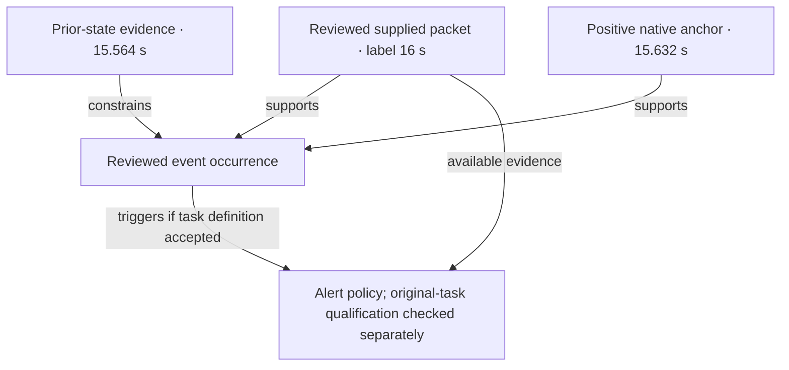

# HA02 — central_display_illumination

Task: `stream_alert_02`. Original instruction: Alert when the printer's central display first becomes illuminated.

**Single-assistant review; independent adjudication pending.**

Separate central LCD illumination from earlier side-button lights. Display later darkens, which does not erase the illumination event.

Original-task qualification: **provisional**.

## Evidence anchors

| Native frame | Source PTS (s) | Role | Visual evidence |
|---:|---:|---|---|
| [460](../../../../full_review/batch_v1/HA02/anchors/000460.jpg) | 15.564464 | pre | Central LCD appears dark immediately before the brightness change. |
| [443](../../../../full_review/batch_v1/HA02/anchors/000443.jpg) | 14.989256 | distractor | Side LEDs are already illuminated while the central display remains dark. |
| [461](../../../../full_review/batch_v1/HA02/anchors/000461.jpg) | 15.598300 | transition | A narrow bright band appears on the central LCD; full-display visibility is transitional. |
| [462](../../../../full_review/batch_v1/HA02/anchors/000462.jpg) | 15.632136 | positive | Central LCD is visibly illuminated with interface content. |
| [473](../../../../full_review/batch_v1/HA02/anchors/000473.jpg) | 16.004329 | corroboration | Central display remains illuminated. |
| [1182](../../../../full_review/batch_v1/HA02/anchors/001182.jpg) | 39.993906 | later_state | Central display appears dark again in the coarse overview. |

## Evidence dependencies

The graph JSON carries additional transitions, corroboration, distractors and later states.
Later evidence is not an initial-alert dependency. Temporal edges do not imply causation.

## Timing and task proposal

The inspected supplied packet labeled **16 s** comes from source PTS **16.478031 s**. It is a reviewed positive packet, not a certified earliest positive.

The legacy deadline remains **21 packet seconds**, an inherited policy choice.

Alert once when the large central LCD visibly illuminates; side-button or status LEDs alone do not qualify.

No gold/scorer migration has been applied. Exact physical onset, first occurrence and native-rate full-clip coverage remain unverified.

## Review coverage

| Inspection | Native frames inspected | Display width |
|---|---:|---:|
| overview | 17 | 320 |
| candidate | 23 | 320 |
| native1 | 16 | 320 |
| delivered | 3 | 480 |

The complete list of indices and sheet hashes is stored in `evidence_graph.json`.
Extracted media remain under ignored `full_review/`; rehydrate with the batch verification scripts.

Flags: `first_occurrence_not_exhaustively_verified`, `physical_onset_unresolved`.
