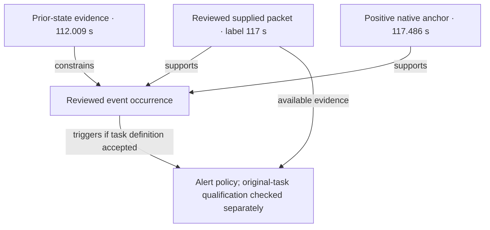

# HA03 — tabletop_placement

Task: `stream_alert_03`. Original instruction: Alert when the round tabletop is placed on the assembled white support frame.

**Single-assistant review; independent adjudication pending.**

Separate carrying/alignment from seated placement and later unsupported standing. Do not infer that every fastener is secure.

Original-task qualification: **provisional**.

## Evidence anchors

| Native frame | Source PTS (s) | Role | Visual evidence |
|---:|---:|---|---|
| [3354](../../../../full_review/batch_v1/HA03/anchors/003354.jpg) | 112.008792 | pre | Round tabletop and upright support frame remain visibly separate. |
| [3444](../../../../full_review/batch_v1/HA03/anchors/003444.jpg) | 115.014395 | transition | Hands guide the tabletop over the upright support frame; support/contact boundary not established. |
| [3518](../../../../full_review/batch_v1/HA03/anchors/003518.jpg) | 117.485668 | positive | Tabletop appears seated on the standing frame; left hand withdraws while right hand remains near the rim. |
| [3593](../../../../full_review/batch_v1/HA03/anchors/003593.jpg) | 119.990337 | corroboration | Assembled table stands without hand support. |

## Evidence dependencies

The graph JSON carries additional transitions, corroboration, distractors and later states.
Later evidence is not an initial-alert dependency. Temporal edges do not imply causation.

## Timing and task proposal

The inspected supplied packet labeled **117 s** comes from source PTS **117.485668 s**. It is a reviewed positive packet, not a certified earliest positive.

The legacy deadline remains **121 packet seconds**, an inherited policy choice.

Alert once when the round tabletop is visibly seated on the upright white support frame; carrying it above or beside the frame does not qualify.

No gold/scorer migration has been applied. Exact physical onset, first occurrence and native-rate full-clip coverage remain unverified.

## Review coverage

| Inspection | Native frames inspected | Display width |
|---|---:|---:|
| overview | 26 | 320 |
| candidate | 33 | 320 |
| native1 | 16 | 320 |
| delivered | 3 | 480 |

The complete list of indices and sheet hashes is stored in `evidence_graph.json`.
Extracted media remain under ignored `full_review/`; rehydrate with the batch verification scripts.

Flags: `contact_boundary_unresolved`, `assembled_security_unverified`.
