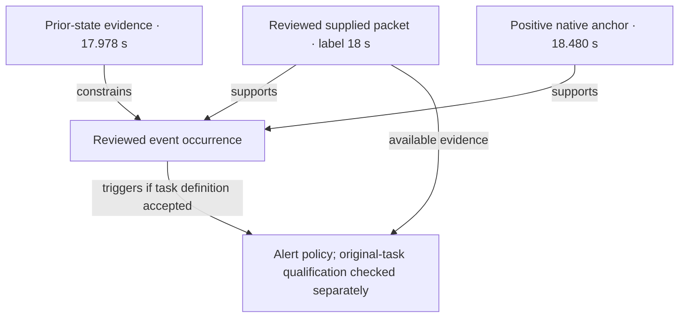

# HA04 — cabinet_access_opening

Task: `stream_alert_04`. Original instruction: Alert when the caution-marked electrical cabinet is opened.

**Single-assistant review; independent adjudication pending.**

Closer inspection separates earlier handle operation and camera motion from actual door opening around 18.3–18.5 s. Later close/reopen is a separate occurrence candidate.

Original-task qualification: **provisional**.

## Evidence anchors

| Native frame | Source PTS (s) | Role | Visual evidence |
|---:|---:|---|---|
| [538](../../../../full_review/batch_v1/HA04/anchors/000538.jpg) | 17.978414 | pre | Main door still appears closed; earlier handle operation has not exposed components. |
| [388](../../../../full_review/batch_v1/HA04/anchors/000388.jpg) | 12.965845 | distractor | Camera viewpoint moves across the cabinet face; this does not establish door opening. |
| [548](../../../../full_review/batch_v1/HA04/anchors/000548.jpg) | 18.312585 | transition | A narrow gap appears as the main door swings outward. |
| [553](../../../../full_review/batch_v1/HA04/anchors/000553.jpg) | 18.479671 | positive | Open-door gap visibly exposes internal components. |
| [568](../../../../full_review/batch_v1/HA04/anchors/000568.jpg) | 18.980928 | corroboration | Larger open-door view confirms the interior. |
| [2394](../../../../full_review/batch_v1/HA04/anchors/002394.jpg) | 80.000602 | later_state | Cabinet face appears closed again in the overview. |
| [3442](../../../../full_review/batch_v1/HA04/anchors/003442.jpg) | 115.021750 | context | A later open interior is visible after intervening closed views. |

## Evidence dependencies

The graph JSON carries additional transitions, corroboration, distractors and later states.
Later evidence is not an initial-alert dependency. Temporal edges do not imply causation.

## Timing and task proposal

The inspected supplied packet labeled **18 s** comes from source PTS **18.479671 s**. It is a reviewed positive packet, not a certified earliest positive.

The legacy deadline remains **24 packet seconds**, an inherited policy choice.

Alert once when opening the main caution-marked door visibly exposes internal components; handle operation and camera motion alone do not qualify.

No gold/scorer migration has been applied. Exact physical onset, first occurrence and native-rate full-clip coverage remain unverified.

## Review coverage

| Inspection | Native frames inspected | Display width |
|---|---:|---:|
| overview | 30 | 320 |
| candidate | 29 | 320 |
| native1 | 16 | 320 |
| extra | 6 | 480 |
| delivered | 3 | 480 |
| anchor_check | 3 | 640 |

The complete list of indices and sheet hashes is stored in `evidence_graph.json`.
Extracted media remain under ignored `full_review/`; rehydrate with the batch verification scripts.

Flags: `opening_extent_policy_needed`, `multiple_occurrences_in_overview`.
