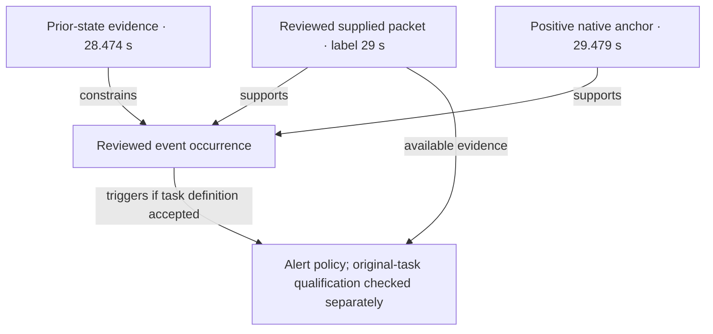

# HA05 — hand_entry_into_hardware_bin

Task: `stream_alert_05`. Original instruction: Alert when the person's hand reaches into the clear bin of metal fasteners.

**Single-assistant review; independent adjudication pending.**

An earlier washer-bin reach is visible around 29.5 s; later screw-bin reach is around 38.5 s. Broad metal-fasteners wording may admit the earlier occurrence, conflicting with legacy early-alert scoring.

Original-task qualification: **requires_adjudication**.

## Evidence anchors

| Native frame | Source PTS (s) | Role | Visual evidence |
|---:|---:|---|---|
| [850](../../../../full_review/batch_v1/HA05/anchors/000850.jpg) | 28.473831 | pre | Hand is approaching the hardware storage area. |
| [865](../../../../full_review/batch_v1/HA05/anchors/000865.jpg) | 28.976310 | transition | Fingers approach the clear bin containing washers. |
| [880](../../../../full_review/batch_v1/HA05/anchors/000880.jpg) | 29.478789 | positive | Hand is visibly inside the washer bin, earlier than the legacy target window. |
| [1149](../../../../full_review/batch_v1/HA05/anchors/001149.jpg) | 38.489919 | context | Hand later enters a different clear bin containing screws. |
| [1194](../../../../full_review/batch_v1/HA05/anchors/001194.jpg) | 39.997358 | context | Small hardware held above the later screw bin. |

## Evidence dependencies

The graph JSON carries additional transitions, corroboration, distractors and later states.
Later evidence is not an initial-alert dependency. Temporal edges do not imply causation.

## Timing and task proposal

The inspected supplied packet labeled **29 s** comes from source PTS **29.478789 s**. It is a reviewed positive packet, not a certified earliest positive.

The legacy deadline remains **43 packet seconds**, an inherited policy choice.

Specify the target bin and contents. If screws are intended, alert once when the hand enters the screw-filled bin; washer-bin entry is a different occurrence.

No gold/scorer migration has been applied. Exact physical onset, first occurrence and native-rate full-clip coverage remain unverified.

## Review coverage

| Inspection | Native frames inspected | Display width |
|---|---:|---:|
| overview | 39 | 320 |
| candidate | 27 | 320 |
| native1 | 16 | 320 |
| native2 | 16 | 320 |
| delivered | 3 | 480 |

The complete list of indices and sheet hashes is stored in `evidence_graph.json`.
Extracted media remain under ignored `full_review/`; rehydrate with the batch verification scripts.

Flags: `task_definition_ambiguous`, `earlier_qualifying_candidate`, `different_bins_must_not_be_merged`.
