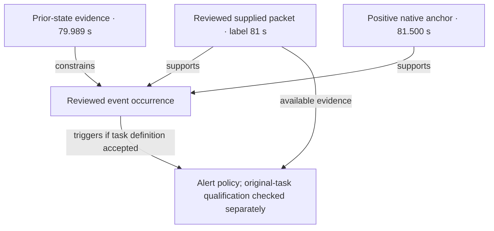

# HA06 — battery_removal

Task: `stream_alert_06`. Original instruction: Alert when the camera battery is removed from the DSLR.

**Single-assistant review; independent adjudication pending.**

Separate opening the compartment, partial ejection, full removal, and later memory-card manipulation.

Original-task qualification: **provisional**.

## Evidence anchors

| Native frame | Source PTS (s) | Role | Visual evidence |
|---:|---:|---|---|
| [2382](../../../../full_review/batch_v1/HA06/anchors/002382.jpg) | 79.988538 | pre | Battery compartment open; battery is not yet clearly free of the camera. |
| [2397](../../../../full_review/batch_v1/HA06/anchors/002397.jpg) | 80.492244 | transition | White rectangular battery protrudes from the compartment while still near the opening. |
| [2413](../../../../full_review/batch_v1/HA06/anchors/002413.jpg) | 81.029531 | transition | Battery is being drawn out; full rear clearance is not certified at this anchor. |
| [2427](../../../../full_review/batch_v1/HA06/anchors/002427.jpg) | 81.499657 | positive | Battery is held clearly outside the camera with visible separation from the compartment. |
| [2442](../../../../full_review/batch_v1/HA06/anchors/002442.jpg) | 82.003363 | corroboration | Battery remains held outside the compartment. |
| [3127](../../../../full_review/batch_v1/HA06/anchors/003127.jpg) | 105.005944 | distractor | Later small memory-card handling is distinct from battery removal. |

## Evidence dependencies

The graph JSON carries additional transitions, corroboration, distractors and later states.
Later evidence is not an initial-alert dependency. Temporal edges do not imply causation.

## Timing and task proposal

The inspected supplied packet labeled **81 s** comes from source PTS **81.499657 s**. It is a reviewed positive packet, not a certified earliest positive.

The legacy deadline remains **86 packet seconds**, an inherited policy choice.

Alert once when the rectangular battery is visibly free of the DSLR battery compartment; opening the door or partially ejecting it alone does not qualify.

No gold/scorer migration has been applied. Exact physical onset, first occurrence and native-rate full-clip coverage remain unverified.

## Review coverage

| Inspection | Native frames inspected | Display width |
|---|---:|---:|
| overview | 25 | 320 |
| candidate | 17 | 320 |
| native1 | 17 | 320 |
| delivered | 3 | 480 |

The complete list of indices and sheet hashes is stored in `evidence_graph.json`.
Extracted media remain under ignored `full_review/`; rehydrate with the batch verification scripts.

Flags: `ejection_vs_full_removal_boundary`.
