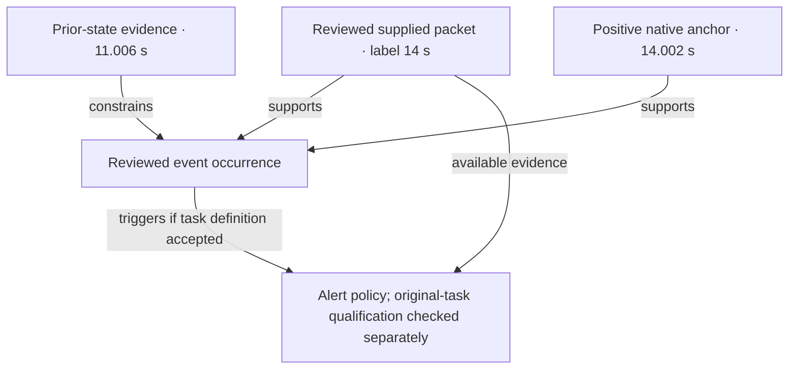

# HA07 — camera_removal_from_insert

Task: `stream_alert_07`. Original instruction: Alert when the action camera is removed from the white packaging insert.

**Single-assistant review; independent adjudication pending.**

Opening the case precedes camera extraction and must not trigger the task. Later accessory/battery work is a different event.

Original-task qualification: **provisional**.

## Evidence anchors

| Native frame | Source PTS (s) | Role | Visual evidence |
|---:|---:|---|---|
| [327](../../../../full_review/batch_v1/HA07/anchors/000327.jpg) | 11.006070 | pre | Action camera rests in the open white insert. |
| [401](../../../../full_review/batch_v1/HA07/anchors/000401.jpg) | 13.496740 | transition | Hands grasp and lift the camera near the insert; clearance still partly occluded. |
| [416](../../../../full_review/batch_v1/HA07/anchors/000416.jpg) | 14.001606 | positive | Camera is visibly raised clear of the insert. |
| [446](../../../../full_review/batch_v1/HA07/anchors/000446.jpg) | 15.011337 | corroboration | Camera held separately above the open packaging. |
| [1634](../../../../full_review/batch_v1/HA07/anchors/001634.jpg) | 54.996692 | distractor | Later battery handling belongs to camera operation, not another removal from packaging. |

## Evidence dependencies

The graph JSON carries additional transitions, corroboration, distractors and later states.
Later evidence is not an initial-alert dependency. Temporal edges do not imply causation.

## Timing and task proposal

The inspected supplied packet labeled **14 s** comes from source PTS **14.472814 s**. It is a reviewed positive packet, not a certified earliest positive.

The legacy deadline remains **20 packet seconds**, an inherited policy choice.

Alert once when the action camera is visibly clear of the white molded insert. Opening the black case or touching the camera while it remains seated does not qualify.

No gold/scorer migration has been applied. Exact physical onset, first occurrence and native-rate full-clip coverage remain unverified.

## Review coverage

| Inspection | Native frames inspected | Display width |
|---|---:|---:|
| overview | 59 | 320 |
| candidate | 21 | 320 |
| native1 | 16 | 320 |
| delivered | 3 | 480 |

The complete list of indices and sheet hashes is stored in `evidence_graph.json`.
Extracted media remain under ignored `full_review/`; rehydrate with the batch verification scripts.

Flags: `clearance_boundary_partly_occluded`.
