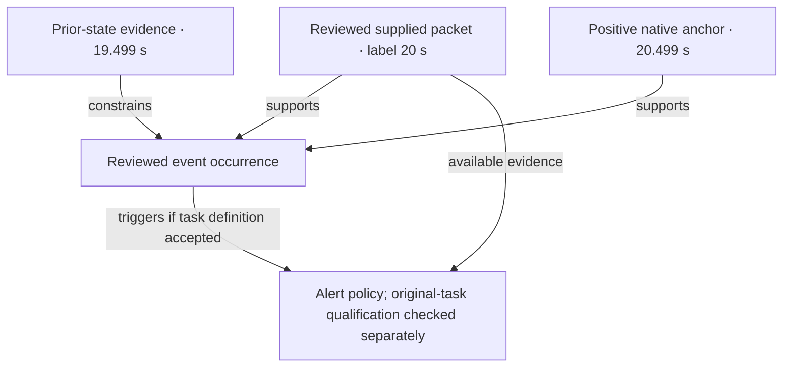

# HA08 — vessel_tipping_over_reservoir

Task: `stream_alert_08`. Original instruction: Alert when the person tips a clear vessel over the open machine reservoir.

**Single-assistant review; independent adjudication pending.**

The visual target is vessel tilt over the opening. Do not infer water flow, amount transferred, or reservoir detachment from this pose alone.

Original-task qualification: **provisional**.

## Evidence anchors

| Native frame | Source PTS (s) | Role | Visual evidence |
|---:|---:|---|---|
| [585](../../../../full_review/batch_v1/HA08/anchors/000585.jpg) | 19.498907 | pre | Vessel held approximately upright beside the open reservoir. |
| [600](../../../../full_review/batch_v1/HA08/anchors/000600.jpg) | 19.998879 | transition | Vessel begins tilting toward the reservoir opening. |
| [615](../../../../full_review/batch_v1/HA08/anchors/000615.jpg) | 20.498851 | positive | Clear vessel visibly tilted with its mouth over the open reservoir. |
| [660](../../../../full_review/batch_v1/HA08/anchors/000660.jpg) | 21.998767 | corroboration | Tilted vessel remains over the reservoir. |
| [750](../../../../full_review/batch_v1/HA08/anchors/000750.jpg) | 24.998599 | later_state | Vessel returned toward an upright pose. |

## Evidence dependencies

The graph JSON carries additional transitions, corroboration, distractors and later states.
Later evidence is not an initial-alert dependency. Temporal edges do not imply causation.

## Timing and task proposal

The inspected supplied packet labeled **20 s** comes from source PTS **20.498851 s**. It is a reviewed positive packet, not a certified earliest positive.

The legacy deadline remains **26 packet seconds**, an inherited policy choice.

Alert once when the clear vessel is visibly tilted with its mouth over the open reservoir. Require this pose, not inferred liquid flow.

No gold/scorer migration has been applied. Exact physical onset, first occurrence and native-rate full-clip coverage remain unverified.

## Review coverage

| Inspection | Native frames inspected | Display width |
|---|---:|---:|
| overview | 31 | 320 |
| candidate | 21 | 320 |
| native1 | 16 | 320 |
| delivered | 3 | 480 |

The complete list of indices and sheet hashes is stored in `evidence_graph.json`.
Extracted media remain under ignored `full_review/`; rehydrate with the batch verification scripts.

Flags: `liquid_transfer_not_verified`, `reservoir_detachment_not_established`.
