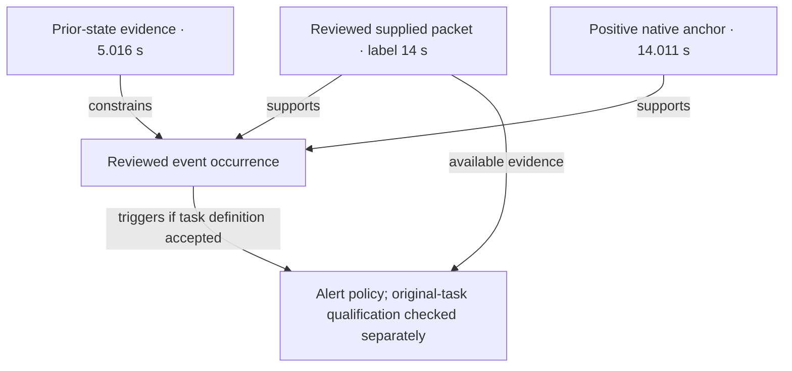

# HA09 — panel_orientation_change

Task: `stream_alert_09`. Original instruction: Alert when the round perforated panel is turned over to expose its underside.

**Single-assistant review; independent adjudication pending.**

The ringed face shown by the legacy positive is already visible earlier. The clip establishes lifting/rotation, but underside identity and a newly revealed underside require adjudication.

Original-task qualification: **requires_adjudication**.

## Evidence anchors

| Native frame | Source PTS (s) | Role | Visual evidence |
|---:|---:|---|---|
| [150](../../../../full_review/batch_v1/HA09/anchors/000150.jpg) | 5.015978 | pre | Ringed face of the panel is already visible on the work surface. |
| [359](../../../../full_review/batch_v1/HA09/anchors/000359.jpg) | 12.004907 | transition | Hand grips the panel before lifting and rotating it. |
| [374](../../../../full_review/batch_v1/HA09/anchors/000374.jpg) | 12.506505 | context | Panel lifted and tilted; visible face changes with pose. |
| [419](../../../../full_review/batch_v1/HA09/anchors/000419.jpg) | 14.011298 | positive | Ringed face is visible while the panel is held up; this does not independently identify an underside. |
| [479](../../../../full_review/batch_v1/HA09/anchors/000479.jpg) | 16.017689 | later_state | Panel subsequently rotates to show its flatter opposite face. |

## Evidence dependencies

The graph JSON carries additional transitions, corroboration, distractors and later states.
Later evidence is not an initial-alert dependency. Temporal edges do not imply causation.

## Timing and task proposal

The inspected supplied packet labeled **14 s** comes from source PTS **14.479456 s**. It is a reviewed positive packet, not a certified earliest positive.

The legacy deadline remains **19 packet seconds**, an inherited policy choice.

Define the target face using an explicit visual description or reference. Do not equate any panel lift/rotation with a verified underside reveal.

No gold/scorer migration has been applied. Exact physical onset, first occurrence and native-rate full-clip coverage remain unverified.

## Review coverage

| Inspection | Native frames inspected | Display width |
|---|---:|---:|
| overview | 59 | 320 |
| candidate | 17 | 320 |
| native1 | 31 | 320 |
| extra | 9 | 480 |
| delivered | 3 | 480 |
| anchor_check | 1 | 640 |

The complete list of indices and sheet hashes is stored in `evidence_graph.json`.
Extracted media remain under ignored `full_review/`; rehydrate with the batch verification scripts.

Flags: `target_face_identity_unverified`, `initial_face_already_visible`, `task_definition_ambiguous`.
