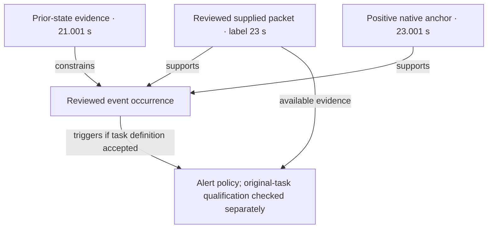

# HA10 — whole_cart_reorientation

Task: `stream_alert_10`. Original instruction: Alert when the upper mesh basket is tilted away from the upright cart frame.

**Single-assistant review; independent adjudication pending.**

Legacy target segment primarily shows reorientation of the whole cart. Tilting away from an upright frame is not supported when the frame tilts too.

Original-task qualification: **requires_adjudication**.

## Evidence anchors

| Native frame | Source PTS (s) | Role | Visual evidence |
|---:|---:|---|---|
| [630](../../../../full_review/batch_v1/HA10/anchors/000630.jpg) | 21.000981 | pre | Cart upright; upper basket seated within the frame. |
| [675](../../../../full_review/batch_v1/HA10/anchors/000675.jpg) | 22.501051 | transition | Performer begins tilting the cart. |
| [690](../../../../full_review/batch_v1/HA10/anchors/000690.jpg) | 23.001075 | positive | Cart and baskets tilt together; independent upper-basket motion relative to the frame is not established. |
| [720](../../../../full_review/batch_v1/HA10/anchors/000720.jpg) | 24.001121 | corroboration | Cart is laid toward its side with the frame and basket still aligned. |
| [4200](../../../../full_review/batch_v1/HA10/anchors/004200.jpg) | 140.006541 | context | Basket separation occurs much later during disassembly in the overview. |

## Evidence dependencies

The graph JSON carries additional transitions, corroboration, distractors and later states.
Later evidence is not an initial-alert dependency. Temporal edges do not imply causation.

## Timing and task proposal

The inspected supplied packet labeled **23 s** comes from source PTS **23.467763 s**. It is a reviewed positive packet, not a certified earliest positive.

The legacy deadline remains **28 packet seconds**, an inherited policy choice.

Either target whole-cart tipping, or annotate the later basket/frame separation separately. Do not use the current relative-basket wording with this window.

No gold/scorer migration has been applied. Exact physical onset, first occurrence and native-rate full-clip coverage remain unverified.

## Review coverage

| Inspection | Native frames inspected | Display width |
|---|---:|---:|
| overview | 68 | 320 |
| candidate | 17 | 320 |
| native1 | 16 | 320 |
| extra | 7 | 480 |
| delivered | 3 | 480 |

The complete list of indices and sheet hashes is stored in `evidence_graph.json`.
Extracted media remain under ignored `full_review/`; rehydrate with the batch verification scripts.

Flags: `target_relative_motion_unsupported`, `whole_object_vs_part_motion`, `task_rewrite_required`.
