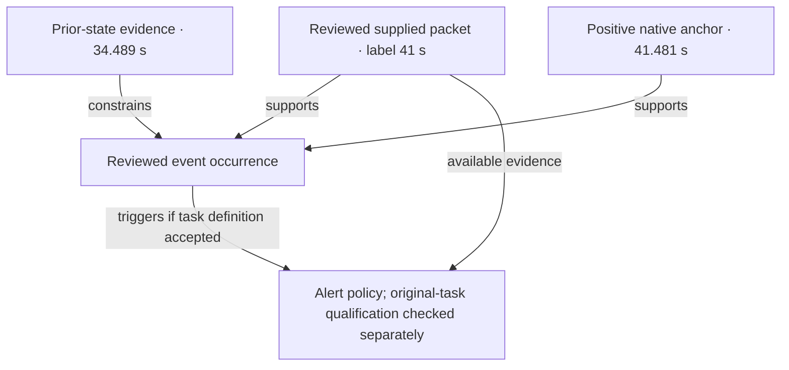

# HB01 — belt_removal

Task: `stream_alert_b2_01`. Original instruction: Alert when the black drive belt is held free of the machine pulleys.

**Single-assistant review; independent adjudication pending.**

Closer review shows a loose belt clear of the pulley route around 41.5 s. The legacy 47 s pre-event checkpoint is already after removal, so valid earlier alerts could be scored false.

Original-task qualification: **provisional**.

## Evidence anchors

| Native frame | Source PTS (s) | Role | Visual evidence |
|---:|---:|---|---|
| [1031](../../../../full_review/batch_v1/HB01/anchors/001031.jpg) | 34.489038 | pre | Black belt still routed over the machine pulleys. |
| [1196](../../../../full_review/batch_v1/HB01/anchors/001196.jpg) | 40.008622 | transition | Belt is being lifted off the remaining pulley route; full clearance is not yet certified. |
| [1240](../../../../full_review/batch_v1/HB01/anchors/001240.jpg) | 41.480511 | positive | Hand lifts the loose belt clear of the exposed pulley route. |
| [1345](../../../../full_review/batch_v1/HB01/anchors/001345.jpg) | 44.992974 | corroboration | Pulleys remain visibly belt-free. |
| [1554](../../../../full_review/batch_v1/HB01/anchors/001554.jpg) | 51.984447 | context | A loose black belt is later visible outside the machine on the floor. |

## Evidence dependencies

The graph JSON carries additional transitions, corroboration, distractors and later states.
Later evidence is not an initial-alert dependency. Temporal edges do not imply causation.

## Timing and task proposal

The inspected supplied packet labeled **41 s** comes from source PTS **41.480511 s**. It is a reviewed positive packet, not a certified earliest positive.

The legacy deadline remains **57 packet seconds**, an inherited policy choice.

Alert once when the belt is visibly clear of every pulley. Slack or lifting from only one pulley does not qualify. Re-annotate the earlier removal interval.

No gold/scorer migration has been applied. Exact physical onset, first occurrence and native-rate full-clip coverage remain unverified.

## Review coverage

| Inspection | Native frames inspected | Display width |
|---|---:|---:|
| overview | 37 | 320 |
| candidate | 19 | 320 |
| extra | 33 | 480 |
| native1 | 16 | 320 |
| delivered | 3 | 480 |

The complete list of indices and sheet hashes is stored in `evidence_graph.json`.
Extracted media remain under ignored `full_review/`; rehydrate with the batch verification scripts.

Flags: `legacy_pre_checkpoint_after_removal`, `physical_release_boundary_partly_occluded`.
