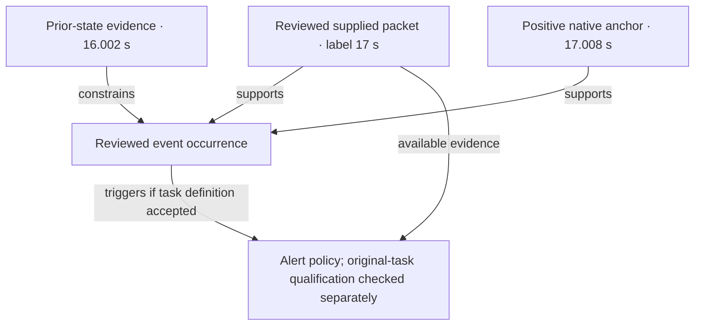

# HB02 — cabinet_door_opening

Task: `stream_alert_b2_02`. Original instruction: Alert when the caution-marked electrical cabinet is opened.

**Single-assistant review; independent adjudication pending.**

Separate handle operation from door opening. Preserve occurrence identity across later close/reopen.

Original-task qualification: **provisional**.

## Evidence anchors

| Native frame | Source PTS (s) | Role | Visual evidence |
|---:|---:|---|---|
| [477](../../../../full_review/batch_v1/HB02/anchors/000477.jpg) | 16.001879 | pre | Main door appears closed while its handle is grasped. |
| [492](../../../../full_review/batch_v1/HB02/anchors/000492.jpg) | 16.505082 | transition | Door swings outward; interior exposure is beginning. |
| [507](../../../../full_review/batch_v1/HB02/anchors/000507.jpg) | 17.008286 | positive | Internal cabinet components visibly exposed beside the opened door. |
| [537](../../../../full_review/batch_v1/HB02/anchors/000537.jpg) | 18.014693 | corroboration | Cabinet remains open. |
| [1789](../../../../full_review/batch_v1/HB02/anchors/001789.jpg) | 60.015431 | later_state | Main door appears closed again. |
| [2534](../../../../full_review/batch_v1/HB02/anchors/002534.jpg) | 85.007883 | context | Later opening exposes the interior again. |

## Evidence dependencies

The graph JSON carries additional transitions, corroboration, distractors and later states.
Later evidence is not an initial-alert dependency. Temporal edges do not imply causation.

## Timing and task proposal

The inspected supplied packet labeled **17 s** comes from source PTS **17.477943 s**. It is a reviewed positive packet, not a certified earliest positive.

The legacy deadline remains **23 packet seconds**, an inherited policy choice.

Alert once when opening the main caution-marked door visibly exposes the cabinet interior; touching the handle alone does not qualify.

No gold/scorer migration has been applied. Exact physical onset, first occurrence and native-rate full-clip coverage remain unverified.

## Review coverage

| Inspection | Native frames inspected | Display width |
|---|---:|---:|
| overview | 24 | 320 |
| candidate | 27 | 320 |
| native1 | 16 | 320 |
| delivered | 3 | 480 |

The complete list of indices and sheet hashes is stored in `evidence_graph.json`.
Extracted media remain under ignored `full_review/`; rehydrate with the batch verification scripts.

Flags: `multiple_occurrences_in_overview`, `opening_extent_policy_needed`.
