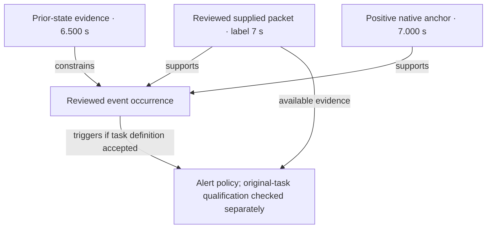

# HB03 — lens_detachment

Task: `stream_alert_b2_03`. Original instruction: Alert when the lens is detached from the DSLR camera body.

**Single-assistant review; independent adjudication pending.**

Separation is visible around 7 s, earlier than the legacy 8 s positive label; later return must not erase history.

Original-task qualification: **provisional**.

## Evidence anchors

| Native frame | Source PTS (s) | Role | Visual evidence |
|---:|---:|---|---|
| [195](../../../../full_review/batch_v1/HB03/anchors/000195.jpg) | 6.499654 | pre | Lens still appears seated against the DSLR body. |
| [210](../../../../full_review/batch_v1/HB03/anchors/000210.jpg) | 6.999628 | positive | Lens held away from the exposed body mount. |
| [240](../../../../full_review/batch_v1/HB03/anchors/000240.jpg) | 7.999575 | corroboration | Lens and body remain separate. |
| [300](../../../../full_review/batch_v1/HB03/anchors/000300.jpg) | 9.999468 | later_state | Lens returned against the body mount. |
| [600](../../../../full_review/batch_v1/HB03/anchors/000600.jpg) | 19.998937 | distractor | Later front-cap handling is distinct from lens detachment. |

## Evidence dependencies

The graph JSON carries additional transitions, corroboration, distractors and later states.
Later evidence is not an initial-alert dependency. Temporal edges do not imply causation.

## Timing and task proposal

The inspected supplied packet labeled **7 s** comes from source PTS **7.499601 s**. It is a reviewed positive packet, not a certified earliest positive.

The legacy deadline remains **13 packet seconds**, an inherited policy choice.

Alert once when the interchangeable lens is clearly separated from the DSLR body. Front-cap removal alone does not qualify.

No gold/scorer migration has been applied. Exact physical onset, first occurrence and native-rate full-clip coverage remain unverified.

## Review coverage

| Inspection | Native frames inspected | Display width |
|---|---:|---:|
| overview | 13 | 320 |
| candidate | 17 | 320 |
| native1 | 16 | 320 |
| delivered | 3 | 480 |

The complete list of indices and sheet hashes is stored in `evidence_graph.json`.
Extracted media remain under ignored `full_review/`; rehydrate with the batch verification scripts.

Flags: `physical_release_boundary_unresolved`.
