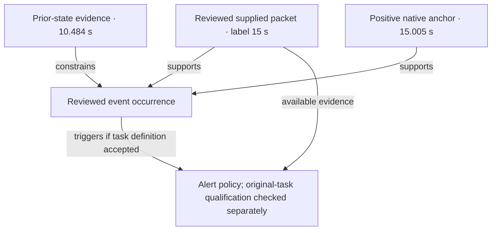

# HB04 — camera_removal_from_insert

Task: `stream_alert_b2_04`. Original instruction: Alert when the action camera is removed from the white packaging insert.

**Single-assistant review; independent adjudication pending.**

Distinguish opening the packaging from the camera clearing its recess.

Original-task qualification: **provisional**.

## Evidence anchors

| Native frame | Source PTS (s) | Role | Visual evidence |
|---:|---:|---|---|
| [313](../../../../full_review/batch_v1/HB04/anchors/000313.jpg) | 10.483535 | pre | Camera seated in the open white insert. |
| [433](../../../../full_review/batch_v1/HB04/anchors/000433.jpg) | 14.502782 | transition | Camera being lifted from the insert; clearance partly obscured by hands. |
| [448](../../../../full_review/batch_v1/HB04/anchors/000448.jpg) | 15.005188 | positive | Camera visibly held clear of the insert. |
| [478](../../../../full_review/batch_v1/HB04/anchors/000478.jpg) | 16.009999 | corroboration | Camera remains outside the insert. |

## Evidence dependencies

The graph JSON carries additional transitions, corroboration, distractors and later states.
Later evidence is not an initial-alert dependency. Temporal edges do not imply causation.

## Timing and task proposal

The inspected supplied packet labeled **15 s** comes from source PTS **15.474100 s**. It is a reviewed positive packet, not a certified earliest positive.

The legacy deadline remains **21 packet seconds**, an inherited policy choice.

Alert once when the action camera is visibly clear of the white molded insert; opening the case or grasping the camera is insufficient.

No gold/scorer migration has been applied. Exact physical onset, first occurrence and native-rate full-clip coverage remain unverified.

## Review coverage

| Inspection | Native frames inspected | Display width |
|---|---:|---:|
| overview | 33 | 320 |
| candidate | 23 | 320 |
| native1 | 16 | 320 |
| delivered | 3 | 480 |

The complete list of indices and sheet hashes is stored in `evidence_graph.json`.
Extracted media remain under ignored `full_review/`; rehydrate with the batch verification scripts.

Flags: `clearance_boundary_partly_occluded`.
