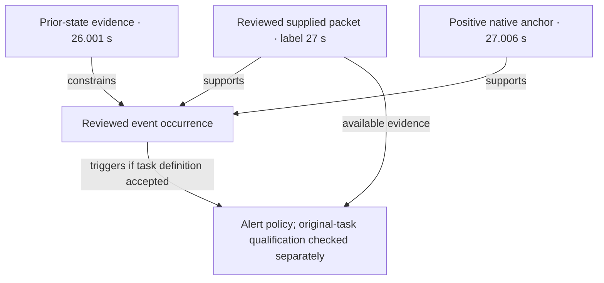

# HB05 — computer_side_panel_removal

Task: `stream_alert_b2_05`. Original instruction: Alert when the desktop computer side panel is removed.

**Single-assistant review; independent adjudication pending.**

Separate moving the whole tower, releasing/sliding the panel, and complete panel removal.

Original-task qualification: **provisional**.

## Evidence anchors

| Native frame | Source PTS (s) | Role | Visual evidence |
|---:|---:|---|---|
| [776](../../../../full_review/batch_v1/HB05/anchors/000776.jpg) | 26.000828 | pre | Black side panel still covers the chassis. |
| [791](../../../../full_review/batch_v1/HB05/anchors/000791.jpg) | 26.503421 | transition | Panel is lifted away from the chassis. |
| [806](../../../../full_review/batch_v1/HB05/anchors/000806.jpg) | 27.006014 | positive | Panel is held clear and the chassis interior is exposed. |
| [836](../../../../full_review/batch_v1/HB05/anchors/000836.jpg) | 28.011201 | corroboration | Computer interior remains exposed with panel set aside. |
| [3134](../../../../full_review/batch_v1/HB05/anchors/003134.jpg) | 105.008497 | later_state | Black panel is being returned over the chassis in the overview. |

## Evidence dependencies

The graph JSON carries additional transitions, corroboration, distractors and later states.
Later evidence is not an initial-alert dependency. Temporal edges do not imply causation.

## Timing and task proposal

The inspected supplied packet labeled **27 s** comes from source PTS **27.475101 s**. It is a reviewed positive packet, not a certified earliest positive.

The legacy deadline remains **33 packet seconds**, an inherited policy choice.

Alert once when the black side panel is visibly clear of the desktop chassis and its interior is exposed.

No gold/scorer migration has been applied. Exact physical onset, first occurrence and native-rate full-clip coverage remain unverified.

## Review coverage

| Inspection | Native frames inspected | Display width |
|---|---:|---:|
| overview | 26 | 320 |
| candidate | 23 | 320 |
| native1 | 16 | 320 |
| delivered | 3 | 480 |

The complete list of indices and sheet hashes is stored in `evidence_graph.json`.
Extracted media remain under ignored `full_review/`; rehydrate with the batch verification scripts.

Flags: `sliding_vs_full_clearance_boundary`.
