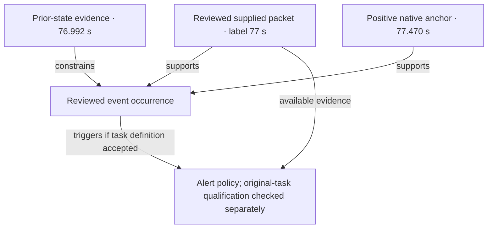

# HB06 — expansion_board_removal

Task: `stream_alert_b2_06`. Original instruction: Alert when the green expansion card is removed from the desktop computer.

**Single-assistant review; independent adjudication pending.**

A green expansion board is visibly removed around 77.5 s, well before the legacy 85 s positive. Avoid merging later board handling into the same occurrence.

Original-task qualification: **provisional**.

## Evidence anchors

| Native frame | Source PTS (s) | Role | Visual evidence |
|---:|---:|---|---|
| [2094](../../../../full_review/batch_v1/HB06/anchors/002094.jpg) | 76.991727 | pre | Hand remains inside chassis at the expansion-board location; full removal not yet visible. |
| [2107](../../../../full_review/batch_v1/HB06/anchors/002107.jpg) | 77.469708 | positive | Green expansion board is held outside the chassis. |
| [2121](../../../../full_review/batch_v1/HB06/anchors/002121.jpg) | 77.984457 | corroboration | Removed board remains outside while the other hand reaches into the computer. |
| [2257](../../../../full_review/batch_v1/HB06/anchors/002257.jpg) | 82.984875 | context | Later additional board handling occurs; board identities should be kept distinct. |

## Evidence dependencies

The graph JSON carries additional transitions, corroboration, distractors and later states.
Later evidence is not an initial-alert dependency. Temporal edges do not imply causation.

## Timing and task proposal

The inspected supplied packet labeled **77 s** comes from source PTS **77.469708 s**. It is a reviewed positive packet, not a certified earliest positive.

The legacy deadline remains **90 packet seconds**, an inherited policy choice.

Alert once when a green expansion board is visibly clear of the desktop chassis. If a particular card is intended, identify that card explicitly.

No gold/scorer migration has been applied. Exact physical onset, first occurrence and native-rate full-clip coverage remain unverified.

## Review coverage

| Inspection | Native frames inspected | Display width |
|---|---:|---:|
| overview | 26 | 320 |
| candidate | 41 | 320 |
| native1 | 15 | 320 |
| extra | 7 | 480 |
| delivered | 3 | 480 |

The complete list of indices and sheet hashes is stored in `evidence_graph.json`.
Extracted media remain under ignored `full_review/`; rehydrate with the batch verification scripts.

Flags: `legacy_positive_late`, `multiple_board_identity_review_needed`.
