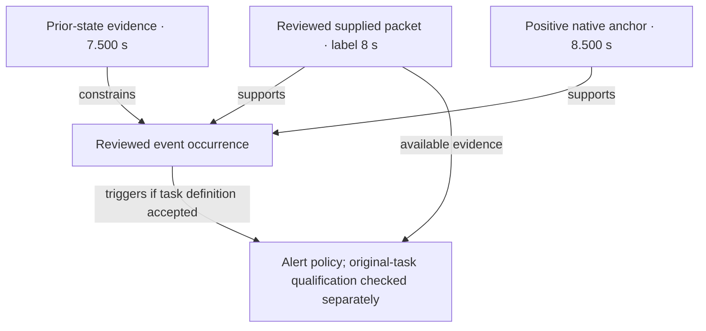

# HB07 — tabletop_removal

Task: `stream_alert_b2_07`. Original instruction: Alert when the round tabletop is lifted off the white support frame.

**Single-assistant review; independent adjudication pending.**

Separate grasping, initial lift, complete clearance and setting the top aside.

Original-task qualification: **provisional**.

## Evidence anchors

| Native frame | Source PTS (s) | Role | Visual evidence |
|---:|---:|---|---|
| [225](../../../../full_review/batch_v1/HB07/anchors/000225.jpg) | 7.499585 | pre | Tabletop appears seated on the white frame while its rim is grasped. |
| [240](../../../../full_review/batch_v1/HB07/anchors/000240.jpg) | 7.999558 | transition | Tabletop starts lifting; clearance from supports is partly obscured. |
| [255](../../../../full_review/batch_v1/HB07/anchors/000255.jpg) | 8.499530 | positive | Round tabletop is visibly lifted clear of the frame. |
| [300](../../../../full_review/batch_v1/HB07/anchors/000300.jpg) | 9.999447 | later_state | Removed tabletop is set on the work surface separately from the frame. |
| [345](../../../../full_review/batch_v1/HB07/anchors/000345.jpg) | 11.499364 | corroboration | Empty support ring visible with tabletop set aside. |

## Evidence dependencies

The graph JSON carries additional transitions, corroboration, distractors and later states.
Later evidence is not an initial-alert dependency. Temporal edges do not imply causation.

## Timing and task proposal

The inspected supplied packet labeled **8 s** comes from source PTS **8.499530 s**. It is a reviewed positive packet, not a certified earliest positive.

The legacy deadline remains **16 packet seconds**, an inherited policy choice.

Alert once when the round tabletop is visibly clear of the white support frame; grasping its rim alone does not qualify.

No gold/scorer migration has been applied. Exact physical onset, first occurrence and native-rate full-clip coverage remain unverified.

## Review coverage

| Inspection | Native frames inspected | Display width |
|---|---:|---:|
| overview | 22 | 320 |
| candidate | 21 | 320 |
| native1 | 16 | 320 |
| delivered | 3 | 480 |

The complete list of indices and sheet hashes is stored in `evidence_graph.json`.
Extracted media remain under ignored `full_review/`; rehydrate with the batch verification scripts.

Flags: `lift_vs_full_clearance_boundary`.
