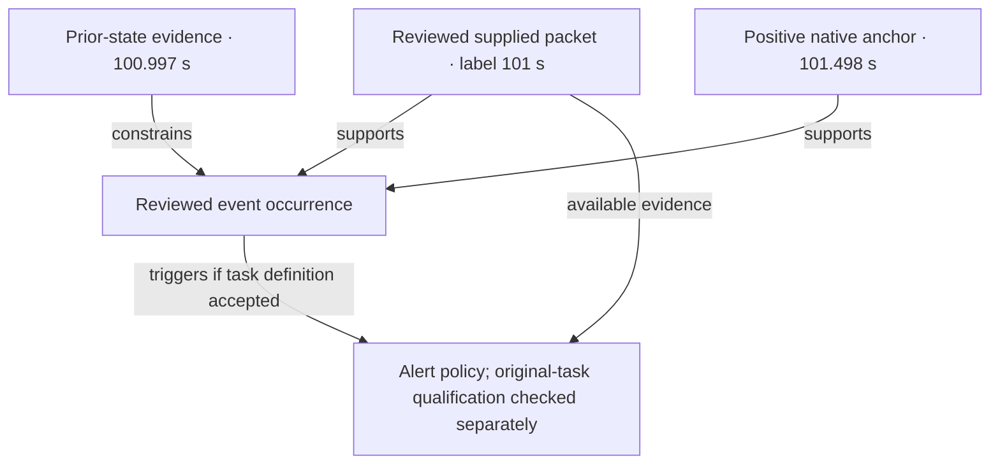

# HB08 — rail_detachment

Task: `stream_alert_b2_08`. Original instruction: Alert when a long black rail is detached from the table frame.

**Single-assistant review; independent adjudication pending.**

Fastener manipulation is preparatory; the target is clearance of one tracked long rail from the remaining frame.

Original-task qualification: **provisional**.

## Evidence anchors

| Native frame | Source PTS (s) | Role | Visual evidence |
|---:|---:|---|---|
| [3029](../../../../full_review/batch_v1/HB08/anchors/003029.jpg) | 100.997374 | pre | Long rail remains against the frame while grasped at its junction. |
| [3044](../../../../full_review/batch_v1/HB08/anchors/003044.jpg) | 101.497526 | positive | Rail is held separately with a visible gap from the remaining frame. |
| [3059](../../../../full_review/batch_v1/HB08/anchors/003059.jpg) | 101.997678 | corroboration | Detached rail carried over the work surface. |
| [3074](../../../../full_review/batch_v1/HB08/anchors/003074.jpg) | 102.497830 | later_state | Rail being set down separately. |

## Evidence dependencies

The graph JSON carries additional transitions, corroboration, distractors and later states.
Later evidence is not an initial-alert dependency. Temporal edges do not imply causation.

## Timing and task proposal

The inspected supplied packet labeled **101 s** comes from source PTS **101.497526 s**. It is a reviewed positive packet, not a certified earliest positive.

The legacy deadline remains **107 packet seconds**, an inherited policy choice.

Alert once when the tracked long black rail is visibly separated from the remaining table frame; unscrewing a fastener alone does not qualify.

No gold/scorer migration has been applied. Exact physical onset, first occurrence and native-rate full-clip coverage remain unverified.

## Review coverage

| Inspection | Native frames inspected | Display width |
|---|---:|---:|
| overview | 57 | 320 |
| candidate | 19 | 320 |
| native1 | 16 | 320 |
| delivered | 3 | 480 |

The complete list of indices and sheet hashes is stored in `evidence_graph.json`.
Extracted media remain under ignored `full_review/`; rehydrate with the batch verification scripts.

Flags: `joint_release_partly_occluded`, `multiple_rails_need_identity`.
