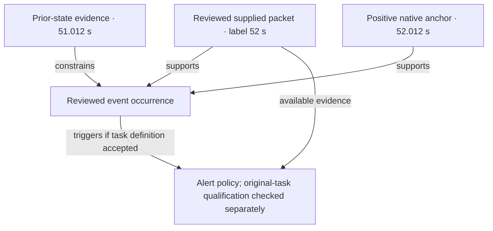

# HB09 — paper_drawer_opening

Task: `stream_alert_b2_09`. Original instruction: Alert when the printer's lower paper tray is pulled open.

**Single-assistant review; independent adjudication pending.**

Specify the paper drawer below the main front cover. Do not merge it with later toner-cover opening.

Original-task qualification: **provisional**.

## Evidence anchors

| Native frame | Source PTS (s) | Role | Visual evidence |
|---:|---:|---|---|
| [1530](../../../../full_review/batch_v1/HB09/anchors/001530.jpg) | 51.012137 | pre | Paper drawer front still near the closed position while handle is raised. |
| [1545](../../../../full_review/batch_v1/HB09/anchors/001545.jpg) | 51.512256 | transition | Drawer begins sliding outward. |
| [1560](../../../../full_review/batch_v1/HB09/anchors/001560.jpg) | 52.012375 | positive | Drawer is visibly extended with paper and interior guides exposed. |
| [1590](../../../../full_review/batch_v1/HB09/anchors/001590.jpg) | 53.012613 | corroboration | Paper drawer remains open. |
| [2399](../../../../full_review/batch_v1/HB09/anchors/002399.jpg) | 79.985698 | distractor | Later toner-access opening exposes cartridges; a different cover and event. |

## Evidence dependencies

The graph JSON carries additional transitions, corroboration, distractors and later states.
Later evidence is not an initial-alert dependency. Temporal edges do not imply causation.

## Timing and task proposal

The inspected supplied packet labeled **52 s** comes from source PTS **52.479153 s**. It is a reviewed positive packet, not a certified earliest positive.

The legacy deadline remains **57 packet seconds**, an inherited policy choice.

Alert once when the paper drawer immediately below the printer main front cover is visibly pulled outward; opening the toner cover does not qualify.

No gold/scorer migration has been applied. Exact physical onset, first occurrence and native-rate full-clip coverage remain unverified.

## Review coverage

| Inspection | Native frames inspected | Display width |
|---|---:|---:|
| overview | 24 | 320 |
| candidate | 13 | 320 |
| native1 | 16 | 320 |
| delivered | 3 | 480 |

The complete list of indices and sheet hashes is stored in `evidence_graph.json`.
Extracted media remain under ignored `full_review/`; rehydrate with the batch verification scripts.

Flags: `drawer_identity_should_be_explicit`.
