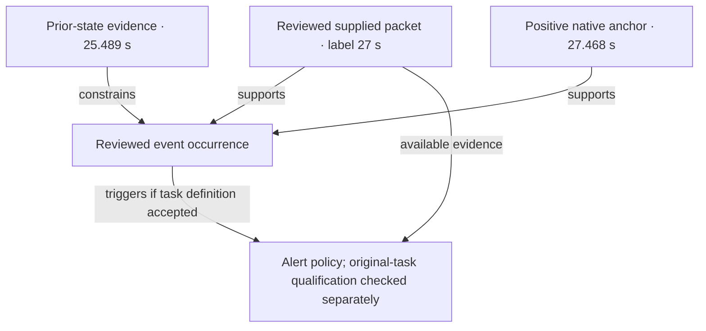

# HB10 — reservoir_under_running_faucet

Task: `stream_alert_b2_10`. Original instruction: Alert when the machine's removable water reservoir is held under the running faucet.

**Single-assistant review; independent adjudication pending.**

Higher-resolution review distinguishes alignment/handle operation at 26–27 s from clearly visible flowing water at about 27.5 s, earlier than the legacy 33 s label.

Original-task qualification: **provisional**.

## Evidence anchors

| Native frame | Source PTS (s) | Role | Visual evidence |
|---:|---:|---|---|
| [671](../../../../full_review/batch_v1/HB10/anchors/000671.jpg) | 22.504099 | context | Reservoir removed from machine before sink interaction. |
| [760](../../../../full_review/batch_v1/HB10/anchors/000760.jpg) | 25.488994 | pre | Reservoir held near the faucet while its handle is operated; water flow not clearly established in this sample. |
| [775](../../../../full_review/batch_v1/HB10/anchors/000775.jpg) | 25.992066 | transition | Faucet operation and reservoir alignment continue; onset of visible flow needs close inspection. |
| [805](../../../../full_review/batch_v1/HB10/anchors/000805.jpg) | 26.998211 | transition | Reservoir is aligned under the outlet; a sustained water stream is not yet clearly visible. |
| [819](../../../../full_review/batch_v1/HB10/anchors/000819.jpg) | 27.467745 | positive | A sustained visible water stream descends into the reservoir opening. |
| [835](../../../../full_review/batch_v1/HB10/anchors/000835.jpg) | 28.004355 | corroboration | Reservoir remains under the clearly running faucet. |
| [1193](../../../../full_review/batch_v1/HB10/anchors/001193.jpg) | 40.011013 | later_state | Reservoir returned to machine in the overview. |

## Evidence dependencies

The graph JSON carries additional transitions, corroboration, distractors and later states.
Later evidence is not an initial-alert dependency. Temporal edges do not imply causation.

## Timing and task proposal

The inspected supplied packet labeled **27 s** comes from source PTS **27.467745 s**. It is a reviewed positive packet, not a certified earliest positive.

The legacy deadline remains **38 packet seconds**, an inherited policy choice.

Alert once when the detached reservoir is visibly positioned under flowing faucet water; holding it under a stopped faucet does not qualify.

No gold/scorer migration has been applied. Exact physical onset, first occurrence and native-rate full-clip coverage remain unverified.

## Review coverage

| Inspection | Native frames inspected | Display width |
|---|---:|---:|
| overview | 46 | 320 |
| candidate | 33 | 320 |
| native1 | 16 | 320 |
| extra | 6 | 480 |
| flow_detail | 10 | 640 |
| native2 | 16 | 320 |
| delivered | 3 | 480 |

The complete list of indices and sheet hashes is stored in `evidence_graph.json`.
Extracted media remain under ignored `full_review/`; rehydrate with the batch verification scripts.

Flags: `legacy_positive_late`, `flow_onset_visibility_uncertain`.
