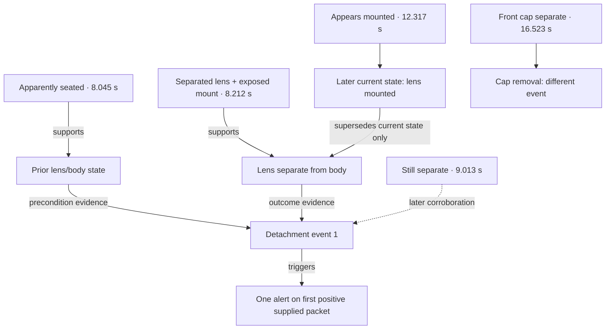

# DSLR lens-detachment evidence review

Reviewed 2026-11-02 by Codex. This is a **single-assistant annotation proposal**,
pending independent review. `evidence_graph.json` is the detailed private graph.
The existing v0 task labels, three-node graphs and scorer are unchanged; the
scorer does not yet consume this graph.

## What was inspected

The pinned MP4's SHA-256 was checked. The complete 68-second clip was inspected
through 136 overview frames, every 15 native frames (approximately 2 FPS).
The detachment was inspected at every native frame from indices 230–270,
with indices 238–247 additionally viewed at 640 pixels wide. Lens return was
inspected every three frames from 285–370; front-cap handling every five frames
from 460–570. These are zero-based presentation-order frame indices. Audio was
not reviewed. This is not exhaustive native-rate review of the whole recording.

## Findings and uncertainty

| Source PTS | Frame index | Observation |
|---|---:|---|
| 8.044704 s | 241 | Lens appears seated against body; interface partly occluded. |
| 8.111465 s | 243 | Lens moving away; interface/gap interpretation uncertain. |
| 8.211607 s | 246 | Conservative positive: exposed body mount and separated lens. |
| 8.345129 s | 250 | Clearer separation and exposed mount. |
| 9.012739 s | 270 | Lens remains separated. |
| 10.514863 s | 315 | Lens returned to mount; contact alone does not prove attachment. |
| 12.317410 s | 369 | Lens appears mounted and stays with body without right-hand support. |
| 16.523355 s | 495 | Front cap held separately while lens remains with camera. |

The first two detachment anchors delimit a **visual-certainty transition**, not
an exact physical unlocking interval. Earlier subtle separation may be detectable;
246 is a conservative positive, not an adjudicated earliest positive. Mechanical
lock engagement is unverified, including after return. The later cap operation
is a different event involving a different object. It must not become a duplicate
lens-detachment event.

## Timing correction

The preparation filter `fps=1` assigns output grid times, which are different
from the PTS of the selected source frames. Scaled decoded-frame MD5 matching
establishes these examples, and the first 12 existing JPEGs reproduce byte-for-byte:

| Legacy packet time | Source frame index | Actual source PTS |
|---:|---:|---:|
| 6 s | 194 | 6.475820 s |
| 7 s | 224 | 7.477236 s |
| 8 s | 254 | 8.478651 s |
| 9 s | 284 | 9.480067 s |

My earlier description of the supplied frames as source-video observations at
exactly 6 and 8 seconds was imprecise. Those numbers are packet-grid labels.
The native positive at 8.211607 s is not itself delivered to the 1 FPS model:
the first positive supplied packet is labeled 8 s and captured at 8.478651 s.
Future corroboration at 9.012739 s must not be used to justify an earlier decision.
The graph marks that dependency separately.

The existing 13-second deadline is retained only as **legacy scoring policy**,
not a video-derived or validated real-world requirement. A future harness should
carry source capture PTS, delivery time, and response wall time separately;
switching to source PTS requires explicit task/scoring migration across the pilot.

## Graph semantics

The graph separates entities, observations, claims, events and decisions.
Edges name their meaning (`supports`, `outcome_evidence_for`, `triggers`, etc.);
temporal succession is not treated as proof of causation.

Reattachment changes current state; it does not erase the historical detachment.
The initial alert needs the positive supplied packet, not the later return or cap
evidence. This clip supports state-transition and object-identity evaluation; the
review does not establish a later-evidence correction of a mistaken past belief.

## Reproduce

From any directory, run this file's sibling `verify.py` with Python 3. It requires
FFmpeg/FFprobe and the existing pinned local MP4 and stream frames. It verifies
source integrity, native PTS anchors, graph endpoints, sampling mappings and
existing input JPEGs. It extracts the eight cited native frames into the ignored
`full_review/` directory. Images and videos are not added to the shareable package.

Next annotation step: a second reviewer should independently identify the earliest
clearly positive frame, assess initial-state evidence, and adjudicate the visibility
transition. Do that before changing gold windows or claiming frame-accurate onset.
